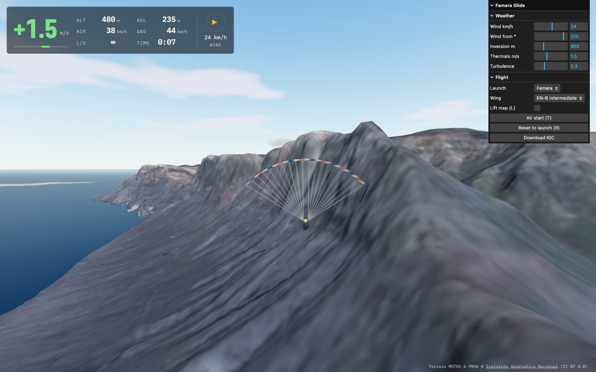
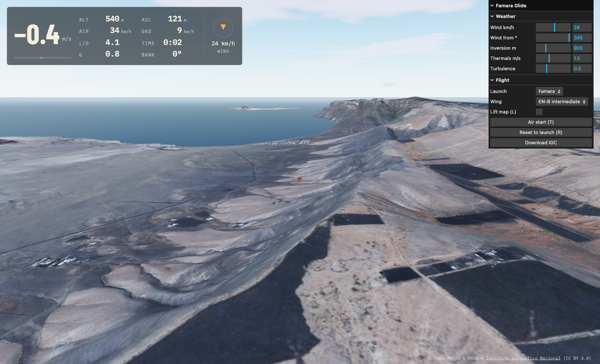

# Famara Glide

[](https://github.com/iloire/paragliding-sim/actions/workflows/ci.yml)

A paragliding simulator prototype at the real **Famara** take-off on Lanzarote, running in the
browser. It is for pilots who know the site and want the air to behave like it does: ridge lift
that depends on the wind angle against the Risco de Famara, a soaring band that tops out, an
inversion that kills it, thermals that mark themselves with cumulus. The wing is a force-based
model, so spirals, wingovers, flares and gust-induced collapses come out of the physics. The
terrain and aerial photo are the real IGN data. The map covers the island's flyable sites: Famara,
Mala, Mirador del Río, Tenesar, El Cuchillo, Macher and Playa Quemada (**N** cycles through them).

This is the **browser prototype** of a planned Unreal Engine game — it proves the flight feel and
the lift model cheaply first. The plan lives in the notes vault (`Projects/paragliding-simulator/plan.md`).






## Run it

```bash
npm install
npm run dev        # http://localhost:5173
```

You start in the air above the launch, facing into the wind (so does switching launch with **N**).
**A/D** brake left/right, **T** air-starts again, **R** puts you on the ground at the launch, where
**W** runs off it into the wind. **L** shows the lift map. **Shift + A/D** is a deep brake (hold it for a spiral dive);
**A/D with Q/E** in rhythm with the swing builds wingovers. A gamepad works too (triggers = brakes). The weather panel on the
right changes wind, inversion and thermals live.

## Check it

```bash
npm test           # flight + air model unit tests (Vitest)
npm run lint
npm run build      # typecheck + production bundle
```

CI runs the same three on every push to `main` and every pull request.

## Terrain data

The height map and orthophoto are committed under `public/sites/famara/`, plus 3 km detail tiles
(native 5 m heights, 1.5 m/px photo) around the launches in `detail/`. To rebuild them, or to add
a site, edit `site.json` and run `npm run fetch-terrain -- <site>` (`--detail` redoes only the tiles). See
[docs/architecture.md](docs/architecture.md) for the data pipeline, the flight model and the
air model, and [docs/physics.md](docs/physics.md) for how the physics works, with diagrams
and charts generated from the model.

## Deploy

Not deployed. It is a static Vite build (`dist/`), so any static host works when it is time.

Terrain: MDT05 and PNOA © [Instituto Geográfico Nacional](https://www.ign.es), CC BY 4.0.
