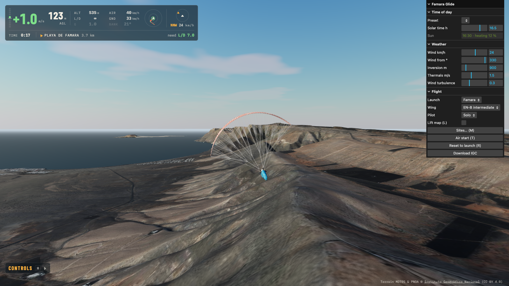
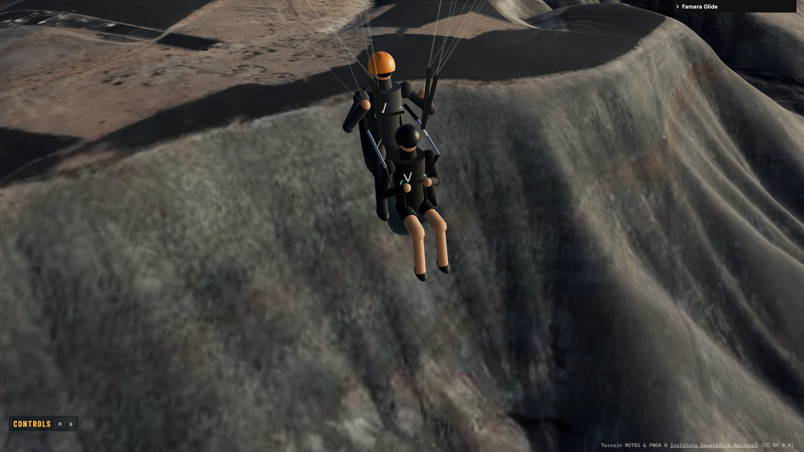
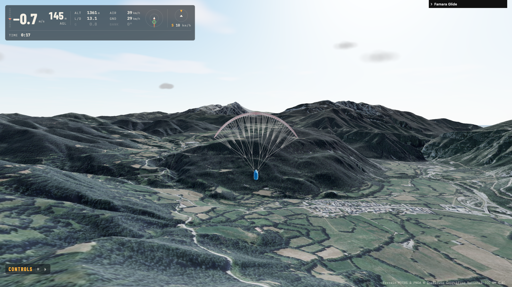
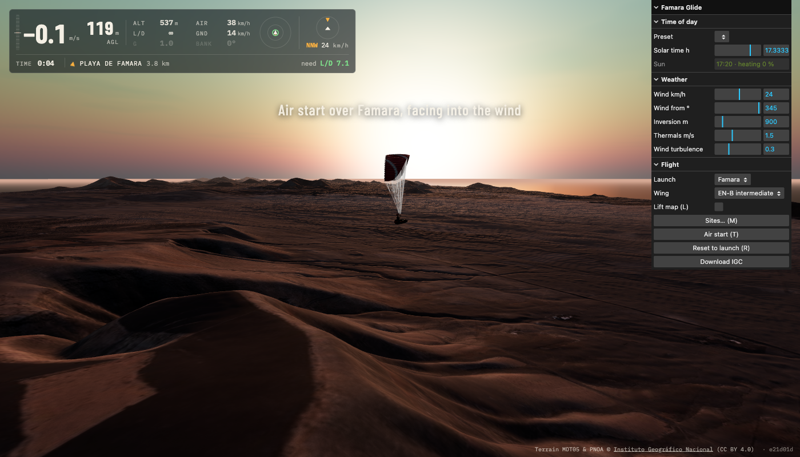
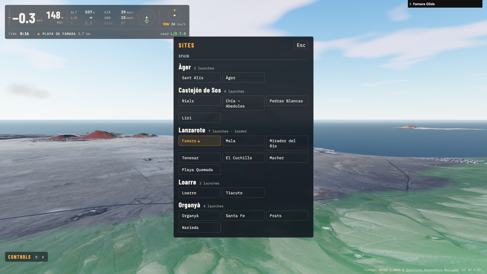

# Famara Glide

[](https://github.com/iloire/paragliding-sim/actions/workflows/ci.yml)

### ▶ Fly it now: **[https://iloire.github.io/paragliding-sim/](https://iloire.github.io/paragliding-sim/)**

A browser paragliding simulator over real terrain, for pilots who want the air to behave like it
does at their sites. It is the prototype of a planned Unreal Engine game: it tests the flight feel
and the lift model cheaply first.

It runs in a desktop browser, or on a phone held sideways. Nothing to install.

[](https://iloire.github.io/paragliding-sim/)

## What's in it

- **Real terrain**: IGN heights and aerial photo, with 5 m / 1.5 m px detail around each launch.
- **Air that works like the real thing**: ridge lift set by the wind angle to the slope, a
  soaring band that tops out, an inversion that caps it, and thermals marked by cumulus.
- **A wing that is a rigid body**: turns, spirals, wingovers, stalls and collapses come out of the
  physics. Nothing is scripted.
- **Solo or tandem**: the tandem flies with a passenger in front, on spreader bars.
- **Speed bar, time of day, sunsets**: thermals are weak in the morning and strongest in the early afternoon.
- **Instruments**: vario, AGL, a thermal assistant, a wind rose, glide to the landing, and IGC export.

| | |
|---|---|
|  |  |
|  |  |
|  | |

## Sites

| Region | Launches |
|---|---|
| **Lanzarote** | Famara, Mala, Mirador del Río, Tenesar, El Cuchillo, Macher, Playa Quemada |
| **Loarre** | Loarre, Tiacuto |
| **Castejón de Sos** | Rials, Chía, Pedras Blancas, Liri |
| **Àger** | Sant Alís, Àger |
| **Organyà** | Organyà, Santa Fe, Prats, Narieda |

**M** opens the site picker. **N** goes to the next launch in the region.

## Run it

```bash
npm install
npm run dev        # http://localhost:5173
```

You start in the air above the launch, facing into the wind.

### Controls

| Key | Does |
|---|---|
| **A / D** | Left / right brake |
| **Shift + A / D** | Deep brake (hold it for a spiral dive) |
| **Q / E** | Weight shift (with A/D in rhythm = wingovers) |
| **W** | Run on the ground, speed bar in the air |
| **T** · **R** | Air start · back to the launch, on the ground |
| **C** · **L** | Camera (orbit, chase, pilot) · lift map |
| **M** · **N** | Site picker · next launch |
| **H** | All controls |

A gamepad works too (the triggers are the brakes). So does a phone held sideways: drag a thumb on
either half of the screen.

The panel on the right sets wind, inversion, thermals, time of day, wing and solo/tandem, all live.

### Share a start

The URL follows the settings, so a link drops someone into the same flight:

```
?region=lanzarote&launch=mala&wind=300/18&time=17:20
```

`wind` is direction/km/h, and `time` is solar time.

## Check it

```bash
npm test           # flight + air model unit tests (Vitest)
npm run lint
npm run build      # typecheck + production bundle
```

CI runs all three on every push to `main` and on every pull request.

## Terrain data

Each region lives in `public/sites/<region>/`: a height map, an orthophoto, and 3 km detail
tiles around the launches.

To add a region or rebuild one:

1. Edit its `site.json`.
2. List it in `public/sites/index.json`.
3. Run `npm run fetch-terrain -- <region>` (`--detail` redoes only the tiles).

## Docs

- [docs/architecture.md](docs/architecture.md): data pipeline, flight model, air model
- [docs/physics.md](docs/physics.md): how the physics works, with diagrams and charts
- [docs/plan-sites.md](docs/plan-sites.md): plan for more sites
- The game plan is in the notes vault (`Projects/paragliding-simulator/plan.md`).

## Deploy

GitHub Pages, from CI. Every push to `main` that passes the tests is built with the
`/paragliding-sim/` base path and deployed. The deploy job then fetches the live page and the site list,
so a green badge means that commit is live.

## Licence

The code is free for non-commercial use under a [custom licence](LICENSE); commercial use (selling it,
paid installations or services, ads) needs a separate licence from the author. The terrain data (MDT05 and PNOA) is © [Instituto Geográfico Nacional](https://www.ign.es),
CC BY 4.0.
