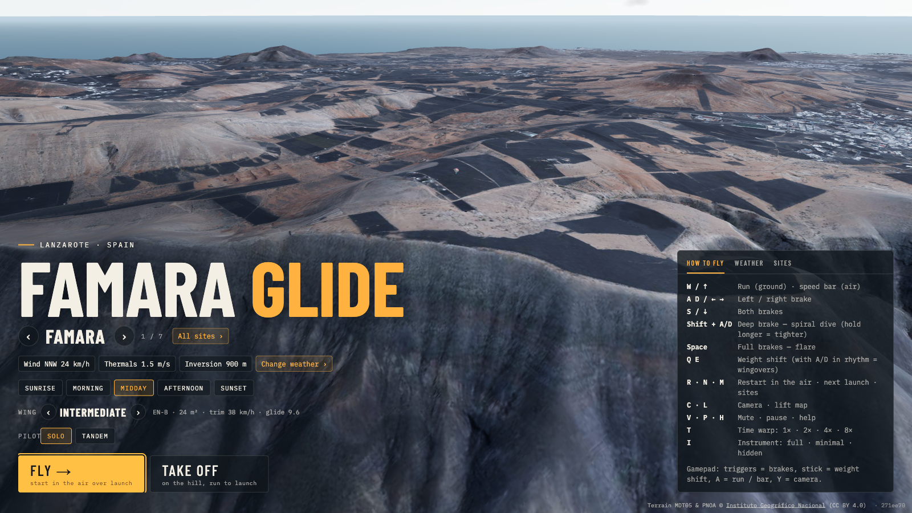

# Famara Glide

https://github.com/user-attachments/assets/1ba96746-a80a-4a2d-8748-9449cd02ba23

[](https://github.com/iloire/paragliding-sim/actions/workflows/ci.yml)

### ▶ Fly it now: **[https://iloire.github.io/paragliding-sim/](https://iloire.github.io/paragliding-sim/)**

A browser paragliding simulator over real terrain, for pilots who want the air to behave like it
does at their sites. It is the prototype of a planned Unreal Engine game: it tests the flight feel
and the lift model cheaply first.

It runs in a desktop browser, or on a phone held sideways. Nothing to install.




## What's in it

- **Real terrain**: IGN heights and aerial photo, with 5 m / 1.5 m px detail around each launch.
- **Air that works like the real thing**: ridge lift set by the wind angle to the slope, a
  soaring band that tops out, an inversion that caps it, and thermals marked by cumulus.
- **A wing that is a rigid body**: turns, spirals, wingovers, stalls and collapses come out of the
  physics. Nothing is scripted.
- **Solo or tandem**: the tandem flies with a passenger in front, on spreader bars.
- **Speed bar, time of day, sunsets**: thermals are weak in the morning and strongest in the early afternoon.
- **Instruments**: vario, AGL, a thermal assistant, a wind rose, glide to the landing, and IGC export.


## Sites

| Region | Launches |
|---|---|
| **Lanzarote** | Famara, Mala, Mirador del Río, Tenesar, El Cuchillo, Macher, Playa Quemada |
| **Loarre** | Loarre, Tiacuto |
| **Castejón de Sos** | Rials, Chía, Pedras Blancas, Liri |
| **Àger** | Sant Alís, Àger |
| **Organyà** | Organyà, Santa Fe, Prats, Narieda |
| **Gran Canaria** | Los Giles, La Isleta |
| **Tenerife** | La Corona, Izaña NW, Izaña SE, Ladera de Güímar, Ifonche, Taucho, Los Gigantes |

The game opens on a welcome screen over the live landscape: the camera circles the launch while
you pick it (← →, or *All sites* for every region), the time of day, the weather, the wing and
solo or tandem. **Fly** starts in the air, **Take off** on the hill. **M** or **Esc** in flight
brings the menu back, with **Resume**. **N** goes to the next launch in the region.

## Run it

```bash
npm install
npm run dev        # http://localhost:5173
```

Pick a launch on the welcome screen and press **Fly** (or Enter) to start in the air above it,
facing into the wind.

### Controls

| Key | Does |
|---|---|
| **W / ↑** | Run on the ground, speed bar in the air |
| **A / D** or **← / →** | Left / right brake |
| **S / ↓** | Both brakes |
| **Shift + A / D** | Deep brake: hold it for a spiral dive, longer to wind it tighter |
| **Space** | Full brakes: flare |
| **Q / E** | Weight shift (with A/D in rhythm = wingovers) |
| **R** | Restart, in the air above the launch |
| **N** · **M** / **Esc** | Next launch · menu (in it: ← → launch, Enter fly, M / Esc resume) |
| **X** | Weather: drag the compass for the wind direction, presets, sliders (Esc or X to close) |
| **C** | Camera: chase (the default), pilot, orbit (drag the mouse) |
| **L** | Lift map |
| **T** | Time warp: 1× · 2× · 4× · 8× |
| **I** | Instrument: full · minimal · hidden |
| **V** · **P** · **H** | Mute the vario · pause · show/hide the controls |

**Gamepad** (standard mapping): left/right trigger = brakes, left stick = weight shift,
A = run / speed bar, RB = speed bar, Y = camera, Back = restart, Start = pause.

**Phone or tablet**, held sideways: one thumb per half of the screen, resting wherever it lands.
Pull it down to brake that side, push it up to run (speed bar in the air), slide it sideways to
shift weight. Both thumbs down is both brakes, both all the way down a flare, one deep a spiral.
A second finger on the same half drags the camera round. The buttons along the top are camera,
restart, sites, instrument and pause.

The panel on the right sets wind, inversion, thermals, time of day, wing and solo/tandem, all live.
The wing is a preset or your own setup: EN class, flat area, aspect ratio and all-up weight, with
a card that shows the resulting polar (see [docs/physics.md](docs/physics.md#wing-setup-size-aspect-ratio-and-weight)).

### Share a start

The URL follows the settings, so a link drops someone into the same flight:

```
?region=lanzarote&launch=mala&wind=300/18&time=17:20
```

`wind` is direction/km/h, and `time` is solar time.

## Check it

```bash
npm test           # flight + air model unit tests (Vitest)
npm run lint
npm run build      # typecheck + production bundle
```

CI runs all three on every push to `main` and on every pull request.

## Terrain data

Each region lives in `public/sites/<region>/`: a height map, an orthophoto, and 3 km detail
tiles around the launches.

To add a region or rebuild one:

1. Edit its `site.json`.
2. List it in `public/sites/index.json`.
3. Run `npm run fetch-terrain -- <region>` (`--detail` redoes only the tiles).

## Docs

- [docs/architecture.md](docs/architecture.md): data pipeline, flight model, air model
- [docs/physics.md](docs/physics.md): how the physics works, with diagrams and charts
- [docs/plan-sites.md](docs/plan-sites.md): plan for more sites
- The game plan is in the notes vault (`Projects/paragliding-simulator/plan.md`).

## Deploy

GitHub Pages, from CI. Every push to `main` that passes the tests is built with the
`/paragliding-sim/` base path and deployed. The deploy job then fetches the live page and the site list,
so a green badge means that commit is live.

## Analytics

[GoatCounter](https://www.goatcounter.com) counts plays and flights, with no cookies and no banner.
Google Analytics 4 runs alongside, with the same takeoff and landing events, once a player taps
OK on a one-line chip (the build gets the ID from the `GA_MEASUREMENT_ID` repo variable).
See [docs/architecture.md](docs/architecture.md#analytics-srcgameanalyticsts).

## Licence

The code is free for non-commercial use under a [custom licence](LICENSE); commercial use (selling it,
paid installations or services, ads) needs a separate licence from the author. The terrain data (MDT05 and PNOA) is © [Instituto Geográfico Nacional](https://www.ign.es),
CC BY 4.0.
