# Flight physics

How the simulator decides where the glider goes: the flight model in `src/sim/glider.ts` and
`polar.ts`, the air in `src/sim/wind.ts` and `thermals.ts`, and the 3D wing and pilot in
`src/game/wing.ts` that show it.

Most charts here come from **running the real sim code** (`npm run physics-figures`, see
[Regenerating the figures](#regenerating-the-figures)), so they show what the model does, not what
we hoped it does. The concept diagrams are drawn by hand.

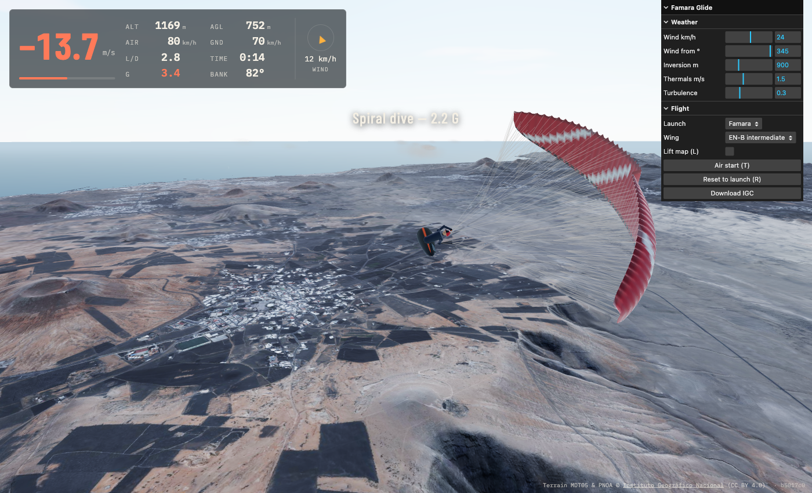

**Contents**

1. [The big picture](#1-the-big-picture)
2. [How the pilot and paraglider are modelled](#2-how-the-pilot-and-paraglider-are-modelled)
3. [Forces and the equations of motion](#3-forces-and-the-equations-of-motion)
4. [The polar: making each wing class fly like its spec](#4-the-polar-making-each-wing-class-fly-like-its-spec)
5. [Pitch: brakes, speed bar and the pitch pendulum](#5-pitch-brakes-speed-bar-and-the-pitch-pendulum)
6. [Roll: turns, spirals and wingovers](#6-roll-turns-spirals-and-wingovers)
7. [Stalls, gusts and collapses](#7-stalls-gusts-and-collapses)
8. [On the ground: take-off and landing](#8-on-the-ground-take-off-and-landing)
9. [The air](#9-the-air)
10. [The 3D wing and pilot](#10-the-3d-wing-and-pilot)
11. [Tuning constants](#11-tuning-constants)
12. [Limits and known gaps](#12-limits-and-known-gaps)
13. [Regenerating the figures](#regenerating-the-figures)

---

## 1. The big picture

The browser loop in `src/main.ts` runs the physics at a **fixed 120 Hz**, however fast the
screen refreshes. Each frame it adds the elapsed time to an accumulator and calls `stepGlider()`
in steps of exactly 1/120 s until the accumulator is spent (capped at 0.25 s, so a stalled tab
doesn't fast-forward the flight). A fixed step means the same inputs always produce the same
flight, on a 60 Hz laptop or a 144 Hz monitor, and the tests can assert exact behaviour.

One step is ten small stages, in this order:

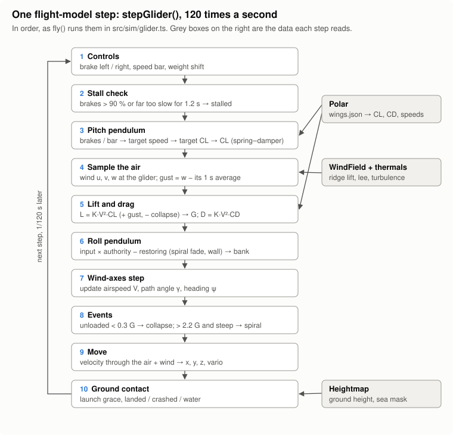

**Coordinate frame.** x points east, y north, z up, in metres, with the origin at the site's
south-west corner. Heading is a compass bearing in radians (0 = north, clockwise). The renderer
converts to three.js axes in `toScene()` (`src/game/world.ts`); the physics never sees them.

**The split.** `src/sim/` is plain TypeScript with no three.js and no DOM. It holds the part
that has to move to the Unreal build unchanged, and it is the part the unit tests cover.
`src/game/` only draws what the sim says.

---

## 2. How the pilot and paraglider are modelled

A real paraglider is two bodies, the canopy and the pilot, joined by about 7 m of lines. The
pilot carries most of the mass and hangs well below the wing. That gives two behaviours that
define how a paraglider flies:

- **Pendulum stability.** The low-slung pilot always pulls the system back towards hanging
  straight under the wing, in pitch and in roll.
- **Lag and overshoot.** Change the brakes and the wing moves first; the pilot follows and
  swings past. That's why a paraglider surges, dives and pitches back instead of snapping to a
  new speed.

The sim does **not** solve the two-body problem: no canopy rigid body, no line tension, no
pilot body. It treats the whole system as **one point mass** and layers the two pendulum
behaviours on top as tuned spring–damper systems:

| What | How the sim represents it | Where |
|---|---|---|
| Glider + pilot mass | One point of **95 kg all-up**, no rotational inertia | `LIFT_K` in `polar.ts` |
| The wing's aerodynamics | Lift and drag from **CL** and **CD** on a **24 m²** wing in sea-level air (ρ = 1.2 kg/m³) | `polar.ts` |
| Wing class (EN-A/B/C) | Six numbers from the speed polar, plus spiral tendency and roll authority | `wings.json` |
| Pitch pendulum | CL follows its target through a damped second-order response | `fly()` → `PITCH` |
| Roll pendulum | Bank is a damped oscillator driven by brakes and weight shift, restored by `sin(bank)` | `fly()` → `ROLL` |
| The pilot | **Inputs only**: brakes, speed bar, weight shift, running. No body in the physics. | `Controls` |
| Canopy deformation | Visual only. Collapse and stall are *states* that change CL and CD. | `GliderState` |

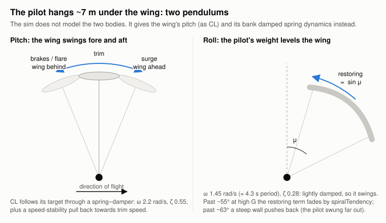

All the forces scale with one constant:

```
K = ρ·S / (2·m) = 1.2 × 24 / (2 × 95) = 0.1516 per metre
L = K·V²·CL      (lift per unit mass, m/s²)
D = K·V²·CD      (drag per unit mass, m/s²)
```

Because everything is per unit mass, a heavier pilot would only change `K`. The all-up weight is
fixed today (see [Limits](#12-limits-and-known-gaps)).

**The state** the sim carries for the glider (`GliderState`): position x, y, z; airspeed V;
flight-path angle γ; heading ψ; bank μ and its rate; CL and its rate; load factor; plus flags
for phase (ground, flying, crashed, water), stall, collapse side and spiral.

---

## 3. Forces and the equations of motion

The model works in **wind axes**: speed and angles are measured along the flight path *through
the air*, not over the ground. Three forces act on the mass:

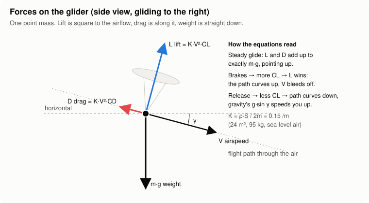

Newton's second law resolved along the path, across it, and sideways gives the three equations
the sim integrates every step:

```
dV/dt = −D − g·sin γ                  along the path: drag slows, diving (γ < 0) speeds up
dγ/dt = (L·cos μ − g·cos γ) / V       across it: spare lift curves the path upward
dψ/dt = L·sin μ / (V·cos γ)           sideways: tilted lift turns the heading
```

Banking tilts the lift vector. The vertical part, `L·cos μ`, has to hold you up. The
horizontal part, `L·sin μ`, is what turns you:

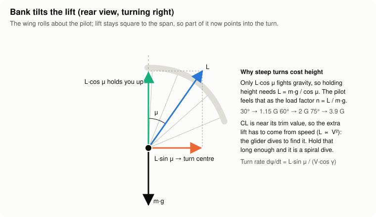

### Why nothing is scripted

None of the manoeuvres has its own code path. They all fall out of these three lines:

- **Glide.** With L·cos μ = g·cos γ, the path stays straight and V settles where drag balances
  the gravity component along the path.
- **Flare.** More CL → L > g·cos γ → γ rises → g·sin γ now slows the glider. Speed becomes
  height.
- **Surge.** Less CL → γ drops → the glider dives and g·sin γ speeds it up.
- **Spiral.** At high bank only a small part of L holds you up, so γ falls, V grows, L grows with
  V², and the turn tightens. Extra drag at high G (`SPIRAL_DRAG`) makes it settle instead of
  accelerating forever.
- **Wingover.** The roll pendulum swings the bank through large angles, and energy moves
  between height and speed on every swing.

### Integration details

The step is semi-implicit Euler: the pendulums update their rates and then their values, then
V, γ and ψ update from the new forces. At 120 Hz that is stable for all the time constants
involved (the stiffest is the pitch spring, ω = 2.2 rad/s, a 2.9 s period). Two guards keep it sane: γ is clamped to
±83° (`GAMMA_LIMIT`), and the heading equation divides by `max(cos γ, 0.15)` so a vertical dive
can't blow up the turn rate.

Position comes from the velocity through the air **plus the wind**:

```
east  = V·cos γ·sin ψ + wind_u
north = V·cos γ·cos ψ + wind_v
up    = V·sin γ       + wind_w      ← this is what the vario hears
```

So a headwind slows you over the ground but not through the air, and rising air lifts you
without the wing noticing, except through gusts ([§7](#7-stalls-gusts-and-collapses)).

---

## 4. The polar: making each wing class fly like its spec

Paraglider performance is published as a **speed polar**: sink rate against airspeed. The sim
starts from six numbers per wing (`src/sim/wings.json`, in km/h):

| Wing | Stall | Min sink | at | Trim | Top (full bar) | Spiral tendency | Roll authority |
|---|---|---|---|---|---|---|---|
| EN-A school | 21 | 1.05 m/s | 30 | 36 | 46 | 0.55 | 0.6 |
| EN-B intermediate | 22 | 1.00 m/s | 32 | 38 | 52 | 0.85 | 0.7 |
| EN-C sport | 24 | 0.95 m/s | 34 | 40 | 58 | 1.3 | 0.8 |

`Polar.sink(V)` turns those into a curve: a parabola through min sink, sitting 0.1 m/s lower than
the sink at trim, plus a steep "mush" term in the last 20 % before the stall:

```
sink(V) = minSink + c·(V − V_minSink)² + 5·mush²        mush: 0 above 1.2 × stall, 1 at 0.8 × stall
```

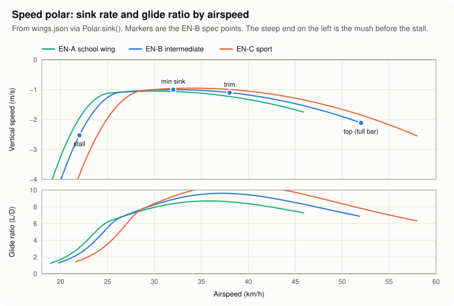

### From the polar to lift and drag coefficients

The force model needs CL and CD, not a sink curve. The polar gives them directly:

1. In a steady glide, lift balances weight, so **CL = g / (K·V²)**. Each airspeed has exactly
   one CL, and vice versa.
2. In a steady glide, sink/V = D/L = CD/CL, so **CD = CL · sink(V) / V**.

`Polar.cdFor(CL)` runs those two steps backwards: from a CL it finds the speed it flies at, reads
the sink there, and returns the CD that reproduces it. **A straight glide therefore matches the
spec exactly**, and the tests check that (`glider.test.ts`, "glides at the polar ratio").

Worked numbers at trim, from the code:

| Wing | Trim | CL | CD | Sink | Glide (L/D) | CL max (at stall) | Sink at full bar |
|---|---|---|---|---|---|---|---|
| EN-A | 36 km/h | 0.647 | 0.0744 | 1.15 m/s | 8.7 | 1.90 | 1.76 m/s |
| EN-B | 38 km/h | 0.581 | 0.0605 | 1.10 m/s | 9.6 | 1.73 | 2.11 m/s |
| EN-C | 40 km/h | 0.524 | 0.0495 | 1.05 m/s | 10.6 | 1.46 | 2.55 m/s |

Best glide falls at about trim speed for all three, as it does on most real wings.

---

## 5. Pitch: brakes, speed bar and the pitch pendulum

### What the controls ask for

Brakes and bar don't set CL directly. They set a **target airspeed** (`Polar.targetSpeed`):

- Symmetric brakes pull it from trim down towards `1.12 × stall`, along `brake^1.3`. The first
  part of the travel does little, the way real brakes feel.
- The speed bar pushes it linearly from trim up to top speed.
- Both together: brakes win. The bar's effect is scaled by `(1 − brake)`.

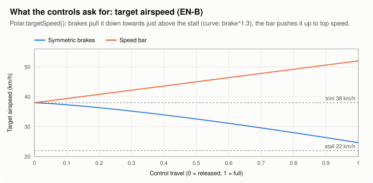

### The pitch pendulum

The target speed gives a target CL (`clFor`). The wing's actual CL then chases it like a mass on
a damped spring:

```
CL_cmd = CL_target · (1 + 0.6·(V − V_target)/V_target)          speed stability
d²CL/dt² = ω²·(CL_cmd − CL) − 2ζω·dCL/dt                         ω = 2.2 rad/s, ζ = 0.55
```

The **speed-stability** term stands in for the pilot's weight. If the glider is faster than its
target, the command asks for more CL, which pitches the wing up and bleeds off the speed. That
is what damps the **phugoid**, the slow swap of speed for height that any glider has. You can
see both in a simple brake-on, brake-off test:

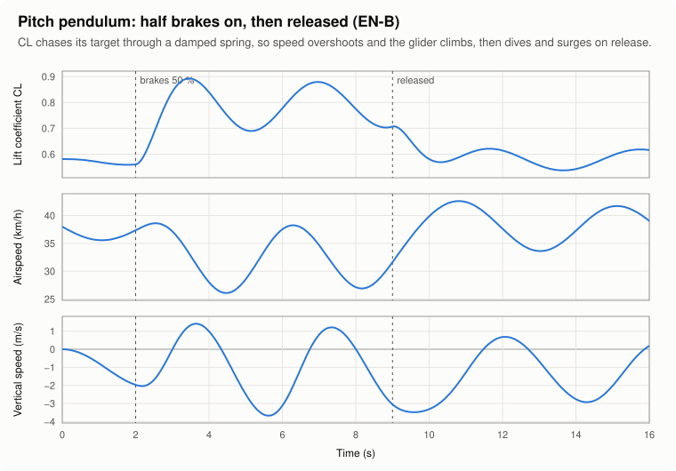

Read it from the top. Half brakes at t = 2 s raise CL in about a second, with some overshoot.
The glider slows and briefly **climbs** (vz > 0, energy turned into height), then oscillates
around its new, slower speed with a period of about 4 s. On release at t = 9 s, CL drops, the
glider dives and **surges** to 43 km/h, then settles back. A pilot "checks" this surge on a real
wing with a dab of brake; here you can do the same.

### The flare

A flare is the same physics at full brake, close to the ground:

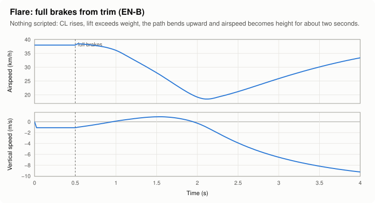

Airspeed falls from 38 to 13 km/h, and for about a second the glider goes **up**, peaking
above 2 m/s. Hold the brakes too long and the speed runs out: vz goes strongly negative and the stall
logic ([§7](#7-stalls-gusts-and-collapses)) takes over. Timing the flare matters, as it does on
a real wing.

---

## 6. Roll: turns, spirals and wingovers

Bank is a second pendulum, with its own spring and damper:

```
input       = (brakeR − brakeL) + deep-brake bite + 0.35·weightShift          clamped to ±2
authority   = min(V / V_trim, 1.2) · rollAuthority
restoring   = sin(μ)·(1 − spiral) + 20·max(|μ| − 1.1, 0)²·sign(μ)
d²μ/dt²     = ω²·(authority·input + collapseRoll − restoring) − 2ζω·dμ/dt     ω = 1.45 rad/s, ζ = 0.28
```

Each term is one piece of how a paraglider really turns:

| Term | What it models |
|---|---|
| `brakeR − brakeL` | Differential brake. The braked side flies slower and drags, so the wing rolls and yaws towards it. |
| **Deep-brake bite** | Past 70 % on one brake, extra input up to +0.8. The inner wing nearly stalls and pivots, and the turn tightens sharply. |
| `0.35·weightShift` | Leaning in the harness. It helps, but it's weaker than the brakes. |
| **Authority** ∝ V | A slow wing turns sluggishly; a fast one responds more. Capped at 1.2× the trim value. |
| `sin(μ)` restoring | The pilot's weight swinging back under the wing. It grows with bank, like a pendulum. |
| **Spiral tendency** | Above ~55° bank *and* 1.5–3 G, the restoring moment fades by `spiralTendency` (smoothstep blends in both). On a wing with tendency > 1 the restoring moment **reverses**, so the spiral holds itself. |
| **Pendulum wall** | Past 63° (1.1 rad), a steep quadratic push back: the pilot has swung far out and the lines won't let the wing go past them. |
| ω, ζ | About a 4.3 s natural period, lightly damped (ζ 0.28) so it swings. That is the rhythm of a wingover. |

### Gentle turns

Hold one brake and the bank settles where the input balances the restoring moment. Below 70 %
brake this is close to linear. Past it, the deep-brake bite and spiral tendency kick in and the
turn turns into a spiral:

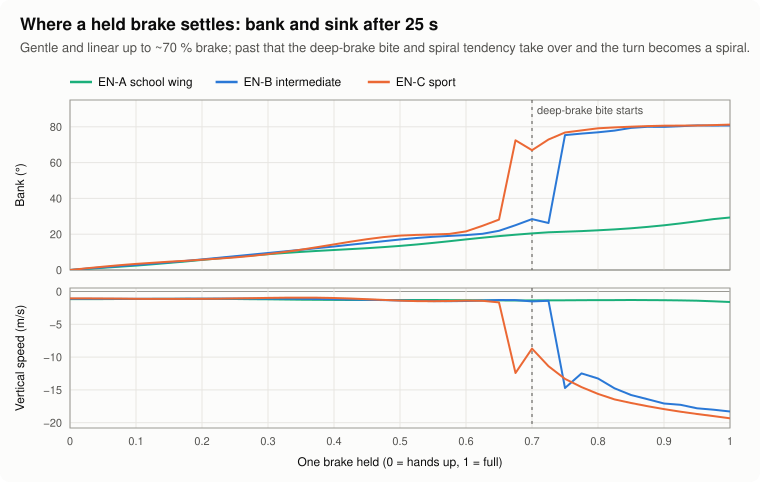

At 70 % brake, after 20 s:

| Wing | Bank | 360° takes | Sink |
|---|---|---|---|
| EN-A | 23° | 14.0 s | 1.4 m/s |
| EN-B | 28° | 12.2 s | 1.5 m/s |
| EN-C | 33° | 10.6 s | 1.7 m/s |

### Spiral dives

Hold one brake fully and the wing winds into a spiral within about 3 s. Extra drag that grows
with G (`SPIRAL_DRAG`, the yawed and braked wing plus the pilot) stops the speed from running
away, so the spiral settles:

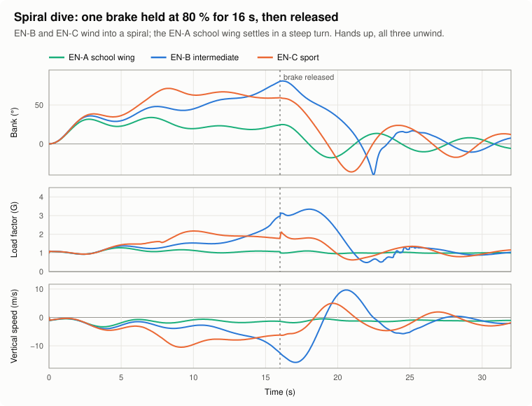

| Wing | Bank | Load | Airspeed | Sink |
|---|---|---|---|---|
| EN-A | 75° | 2.9 G | 46 km/h | 8.4 m/s |
| EN-B | 78° | 3.2 G | 50 km/h | 10.5 m/s |
| EN-C | 81° | 3.5 G | 55 km/h | 13.1 m/s |

Release the brake at t = 12 s and **all three come out on their own** within about 2 s. They
overshoot to the other side, then convert the stored speed into a climb (the vz spike at 14 s)
and swing back to level over a few phugoid cycles. A higher spiral tendency makes the spiral
steeper and faster, but with these numbers even EN-C does not stay locked in once the brake is
released. Tests: `glider.test.ts`, "winds into a spiral dive…".

The HUD flags `spiral` when the load passes 2.2 G above about 52° bank, and clears it below
1.4 G.

### Wingovers

Because the roll pendulum is lightly damped, you can **pump** it: reverse the input each time
the roll rate reverses, in time with the ~4.3 s swing, and every swing gets bigger:

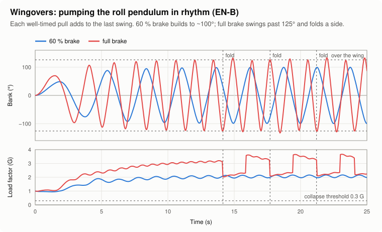

The bank passes 90° on the third swing and the wall holds it at about ±105°. With this timing
the load stays near 2 G. Time the input badly at the top of a swing and the load can drop below
0.3 G, which folds the wing ([§7](#7-stalls-gusts-and-collapses)).

---

## 7. Stalls, gusts and collapses

### Stall

A timer counts up while the brakes are past 90 % **or** the airspeed is below 0.8 × stall, and
counts down twice as fast otherwise. After 1.2 s the wing stalls:

- CL is commanded to 30 % of CL max, and CD jumps to 1.0. The glider loses its forward speed and
  drops, with a sink above 4 m/s.
- The bank decays towards level (a stalled wing sits back over the pilot).
- **Recovery:** hands up (brakes below 40 %) until the timer falls under 0.6 s.

### Gusts

The wing feels a change in vertical air, not the air itself. A slowly rising thermal just
carries you, but a sharp edge changes the angle of attack. The sim keeps a 1-second low-pass
filtered copy of the vertical air (`airW`), and treats the difference as a gust:

```
gust = w_air − airW                   (airW follows w_air with τ = 1 s)
CL_effective = CL + 2.5 · gust / V    (an up-gust raises the angle of attack, a down-gust drops it)
```

### Collapses

If the load factor stays **below 0.3 G for 0.15 s** (the wing is unloaded and the lines go
slack), one side folds. It's the high side of the current bank, or the left when level:

- The folded wing loses 35 % of its lift and gains 0.04 of CD.
- A roll moment of 0.55 pulls towards the folded side, so the glider turns.
- It reopens after 2.5 s. Pumping the brake on the folded side speeds that up, up to twice as
  fast at full pump.
- There's no collapse during the 2.5 s launch grace, so you can't fold on take-off.

A 5 m/s down-gust from still air shows the whole chain:

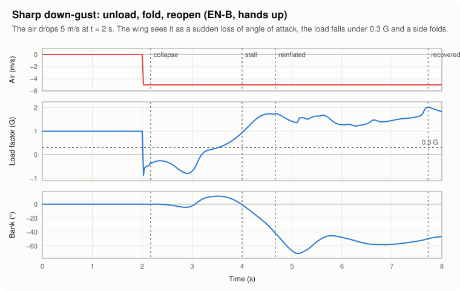

The load drops instantly from 1 G to −0.3 G, a side folds 0.15 s later, and the glider banks
about 45° towards it. When the side reinflates at t ≈ 4.7 s the lift comes back at once, and
the glider, now fast from the dive, pulls 3 G. Ordinary bumps (±0.6 m/s) never come close; a
test checks that too.

---

## 8. On the ground: take-off and landing

On the ground the glider isn't flying. Its airspeed is just your run speed plus the headwind.

- **Running** (hold W) builds speed at 2.5 m/s² up to 4.2 m/s. With no run speed, the brakes
  turn you on the spot to face the wing round.
- **Lift-off** happens when the airspeed reaches 1.1 × stall, or when the ground drops more
  than 1 m ahead and you have at least 0.6 × stall. The wing overhead is already flying, so you
  leave at trim speed and trim CL.
- **Launch grace.** For 2.5 s after lift-off, touching the slope while still running is a
  stumble: you go back to running, not to a landing.
- **Touchdown** is a **crash** if any of these is true: sink above 3.5 m/s, ground speed above
  11 m/s, stalled, or bank above 0.6 rad (34°). Otherwise it's a landing. Touching the sea is
  `water`.

---

## 9. The air

`WindField.sample(x, y, z, t)` gives the air's velocity (u east, v north, w up) at any point.
It's the sum of four parts: the wind, ridge lift and lee sink from the terrain, thermals, and
turbulence.

### Wind and its gradient

The wind blows from one direction at one speed (the weather panel), shaped by height:

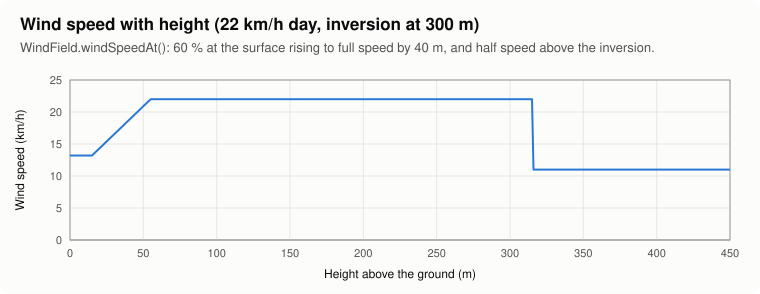

- **Near the ground:** 60 % of the set speed at the surface, rising linearly to full speed at
  40 m. That's surface friction, and it's why a landing feels calmer than the air you
  were soaring in.
- **Above the inversion:** half speed. A crude two-layer atmosphere.

### Ridge lift

The air has to climb over terrain in its way. How fast it rises depends on how steep the slope
is **along the wind**: a face square to the wind lifts most, and one the wind runs along
doesn't lift at all. The model follows the notes vault's *coastal-soaring-lift-factors* note:

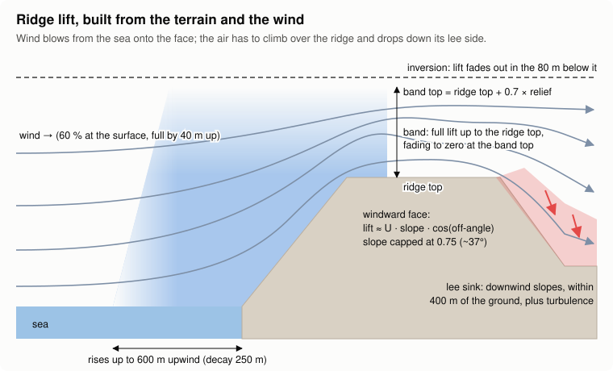

It's built once per wind direction on a 512² grid over the site (about 82 m cells over the
42 km island), and only scaled when the wind speed changes:

1. **Smooth** the heightmap with a 120 m Gaussian blur, so the air sees the shape of the
   cliff, not every gully.
2. **Slope along the wind**, from the gradient of the smoothed ground projected on the wind
   direction. The steepness is capped at 0.75 (37°) *before* projecting, so a sheer cliff gives
   strong lift, not infinite lift, and the cosine law survives.
3. **Reach upwind.** The air starts rising before it hits the face. Each cell takes the
   strongest windward slope within 600 m downwind of it, weighted by `exp(−distance/250 m)`.
4. **Ridge top and foot.** For each cell: the highest ground within 1.5 km downwind (the ridge
   the air must clear) and the lowest within 1.5 km upwind (where the climb started).

At runtime, `ridgeLift()` combines those with the weather:

```
lift   = slope·U · band · lid · stability
band   = 1 below the ridge top, fading to 0 at ridge top + 0.7 × relief (relief ≥ 50 m)
lid    = fades to 0 over the last 80 m below the inversion
stability = 0.4 + (inversion − ridge top)/300, clamped to 0.25–1
lee    = negative slope·U · 0.7, only within 400 m of the ground
```

A **low inversion** does two things: the lid caps the band, and when it sits at or below the
ridge top, `stability` weakens the lift as the air goes round the hill instead of over it. Here
is the model on the test cliff (400 m high, 22 km/h straight onto it), with a high inversion and
then a low one:

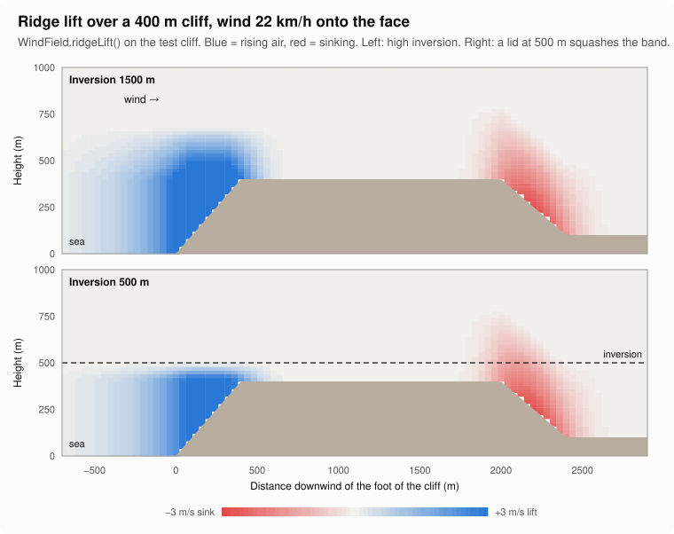

And the wind-angle law, with the wind swung off the face normal and lift measured 50 m above the
cliff top:

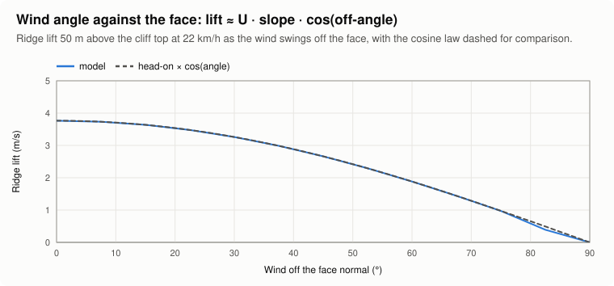

It tracks `cos(angle)` almost exactly, as the projection in step 2 intends. The small dip near
90° comes from the blur and the cap. At Famara this is why a north-westerly works and a
northerly, running along the Risco, barely does.

### Thermals

`ThermalField` keeps **24 thermals** alive over the site, from a seeded random generator, so a
replay or a test sees the same sky.

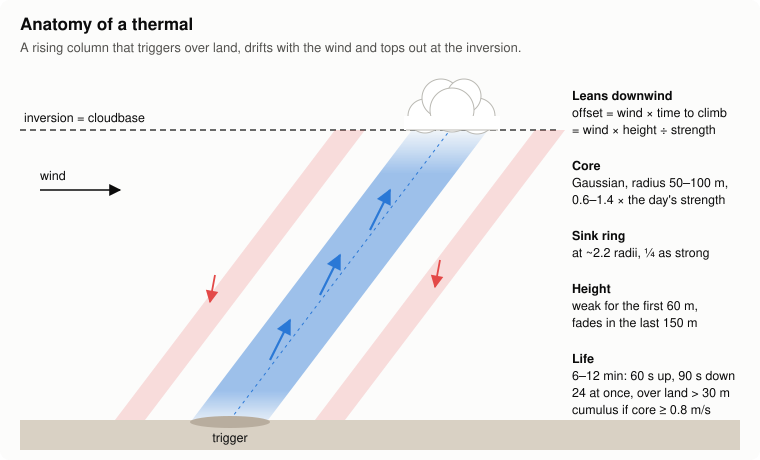

- **Trigger:** a random point on land above 30 m. Strength is 0.6–1.4 × the day's setting,
  radius 50–100 m.
- **Life:** 6–12 minutes, with a 60 s ramp up and a 90 s decay, and replaced when it ends. On
  the first fill their ages are staggered, so the sky doesn't pop into existence all at once.
- **Drift:** the column leans downwind. At height h above its trigger, the centre has moved by
  `wind × h / strength`, the distance the wind carried the air while it climbed.
- **Profile:** a Gaussian core, plus a ring of sink at 2.2 radii, a quarter as strong. You can
  feel the edges, and you can fall out of one.
- **Vertical shape:** 30 % strength at the trigger, reaching full strength over the first 60 m,
  and fading over the last 150 m below cloudbase (the inversion). Above it there's nothing.
- **Cumulus:** a mature thermal (envelope above 0.3, strength at least 0.8 m/s, cloudbase at
  least 200 m above the trigger) puts a cloud at cloudbase, over the leaned top of the column.

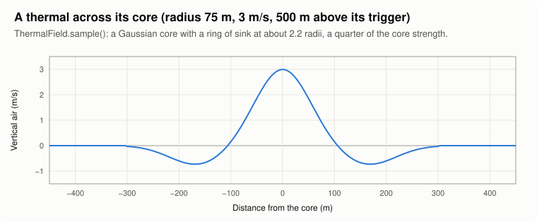

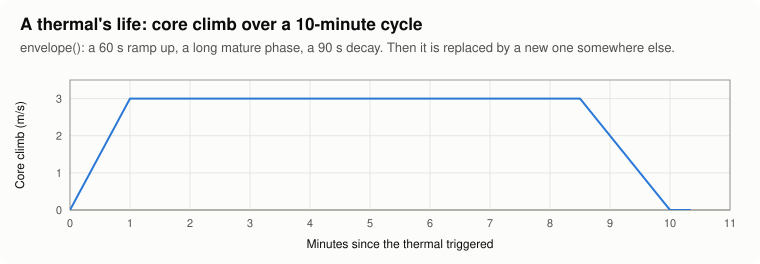

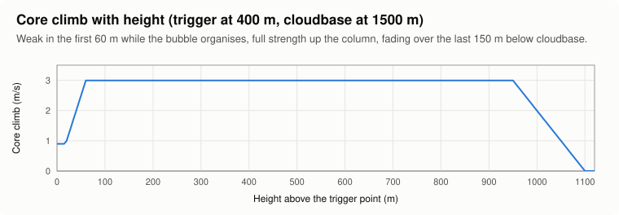

### Turbulence

Turbulence is cheap, smooth pseudo-noise: three layers of sines at unrelated frequencies in x, y
and t, returning −1..1. No grid, no state, deterministic. Its amplitude is
`turbulence × (0.4 + 2 × leeness) × min(U/6, 1.5)`: stronger in the lee of the hill, and
stronger the windier it is. It enters as vertical air, so it reaches the wing through the gust
term in [§7](#7-stalls-gusts-and-collapses), and on a rough day it can fold a side.

---

## 10. The 3D wing and pilot

Everything above is the physics. `src/game/wing.ts` is what you **see**. It is procedural:
built from parameters in code, not loaded from a model file, so every frame it can bend the
canopy for brakes and collapses and pose the pilot. It reads the sim's state and never writes
to it.

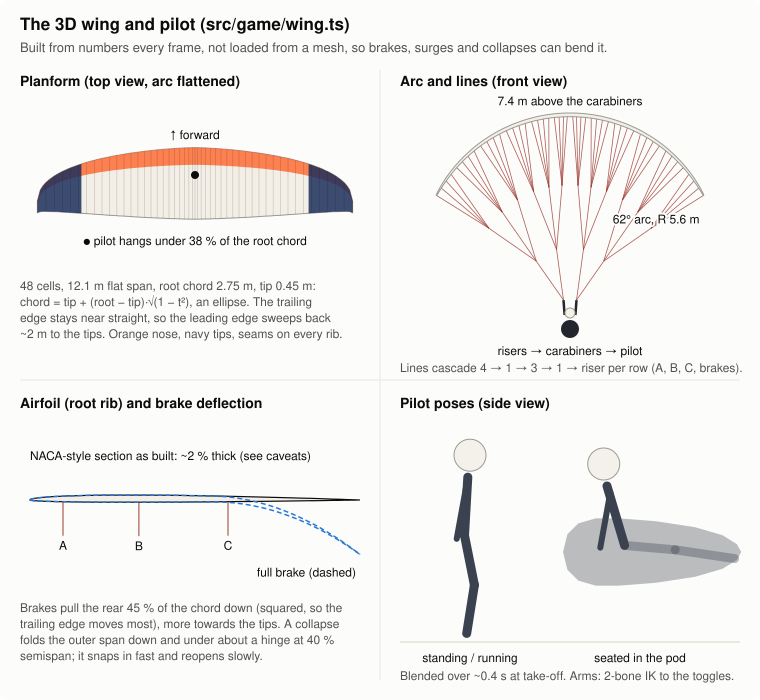

### The canopy

- **Planform:** 48 cells over a 12.1 m flat span. The chord follows an ellipse,
  `0.45 + 2.3·√(1 − t²)` m, where t runs −1..1 tip to tip, so the root chord is 2.75 m and the
  tips 0.45 m. The trailing edge is nearly straight (`1.7 − 0.25·t²` m behind the pilot), so
  the leading edge sweeps back about 2 m to the tips, as on a real wing. The pilot hangs under
  about 38 % of the root chord.
- **Arc:** the span is bent around a 5.6 m radius, through 62° each side
  (`angle = 62°·|t|^1.3`, flatter in the middle). The top of the wing sits 7.4 m above the
  carabiners.
- **Section:** a NACA 4-digit thickness shape, cosine-spaced (16 points per surface) so the
  rounded nose is smooth, with a flatter underside (45 % of the top's thickness).
- **Cells:** three spanwise vertices per cell. The top surface puffs out between ribs, the
  trailing edge scallops in mid-cell, and the intakes under the nose are dark gaps between
  the ribs.
- **Colours:** an orange nose for the first 24 % of the chord, navy tips past 77 % of the
  semispan, slightly darker seams on every rib, shaded underside. A `MeshPhysicalMaterial` with
  sheen gives the fabric its soft highlight.

### Lines and risers

Each half-wing has four line rows: **A** (10 % chord), **B** (33 %), **C** (60 %) and
**brakes** (trailing edge, outer 80 % of the span). Each row **cascades** the way real lines
do. Groups of four attachment points join at an upper node, groups of three upper nodes join at
a middle node, and each middle node runs to the riser. A and B go to the A riser, C to the rear
riser, and the brake lines run to the brake handles. The lines are recomputed from the deformed
canopy every frame, so they follow a collapse or a brake pull.

### Driving the model from the sim

| Seen | Driven by |
|---|---|
| Whole rig's position and orientation | Position; yaw from heading; roll from bank and pitch from γ while flying |
| Canopy **surges ahead / drops back** | `clRate × 0.9` (clamped ±0.4 rad), smoothed. The wing pitches forward when CL is falling: the surge. |
| Canopy **leads into turns** | `−bankRate × 0.12`, smoothed: the wing rolls first and the pilot swings after it |
| **Brake deflection** | The rear 45 % of the chord is pulled down, quadratically towards the trailing edge, more towards the tips (30 % at the centre, 100 % at the tip) |
| **Collapse** | The outer span folds down and under about a hinge at 40 % semispan, up to 155°, and drags back. It folds fast (rate 9/s) and reopens slowly (2/s). |
| Pilot **hands** | Two-bone IK (0.30 m upper arm and forearm) to the brake handles, which hang from the canopy, so the hands move when the wing surges. The elbows point out and back. |
| Pilot **lean** | Weight shift rolls the body up to 0.14 rad |

### The pilot

The pilot is built from primitives: a cylinder torso, sphere joints, cylinder limbs, a helmet
with a visor, and a **pod harness**. The pod is a lathe (a rotated teardrop profile) from the
rounded back protector to the pointed foot, with orange piping and a flight deck on top.

Two key poses blend with a filter of about 0.4 s:

- **Standing / running** on the ground: legs scissor with run speed, body leans forward, and the
  pod hangs folded behind the legs.
- **Seated** in flight: reclined, legs forward inside the pod (the legs are hidden once the pod
  closes), head tilted to look ahead.

---

## 11. Tuning constants

The constants that shape the feel. All are in `src/sim/glider.ts` unless noted. Change one,
then run `npm test` (the tests pin the envelope) and `npm run physics-figures` to see the
effect.

| Constant | Value | Effect |
|---|---|---|
| `LIFT_K` (`polar.ts`) | 0.1516 /m | ρS/2m: 24 m², 95 kg, sea level |
| `TRIM_SINK_PENALTY` (`polar.ts`) | 0.1 m/s | Sink at trim above min sink: the polar's curvature |
| `PITCH` | ω 2.2, ζ 0.55 | How quickly CL follows the brakes, and how much it overshoots |
| `SPEED_STABILITY` | 0.6 | How hard the wing returns to trim speed; damps the phugoid |
| `ROLL` | ω 1.45, ζ 0.28 | Roll period (~4.3 s) and how long it keeps swinging |
| `WEIGHT_SHIFT_SHARE` | 0.35 | Weight shift relative to the brakes |
| `DEEP_BRAKE`, `DEEP_BRAKE_GAIN` | 0.7, 0.8 | Where one brake starts to bite, and how hard |
| `AUTHORITY_MAX` | 1.2 | Cap on speed-dependent roll authority |
| `BANK_WALL`, `BANK_WALL_GAIN` | 1.1 rad, 20 | Where the pendulum wall starts, and how stiff it is |
| `SPIRAL_DRAG` | 0.04 per G above 1 | How deep a spiral settles |
| `TURN_DRAG` | 0.02 × brake difference | Drag cost of turning |
| `SPIRAL_LOAD` | 2.2 G | Threshold for the HUD's spiral flag |
| `GUST_CL`, `GUST_TAU` | 2.5, 1 s | Gust sensitivity, and what counts as "sudden" |
| `COLLAPSE_LOAD`, `COLLAPSE_SECONDS` | 0.3 G, 2.5 s | When a side folds and how long it stays folded |
| `STALL_CL_FACTOR`, `STALL_CD` | 0.3, 1.0 | How hard a stall bites |
| `GAMMA_LIMIT` | 1.45 rad | Path-angle clamp |
| `RUN_MAX`, `RUN_ACCEL` | 4.2 m/s, 2.5 m/s² | Take-off run |
| `HARD_LANDING_SINK`, `HARD_LANDING_SPEED` | 3.5 m/s, 11 m/s | Crash thresholds |
| `LAUNCH_GRACE` | 2.5 s | Stumble window after lift-off |
| `BLUR_SIGMA_M` (`wind.ts`) | 120 m | How smooth a hill the air sees |
| `UPWIND_REACH_M`, `UPWIND_DECAY_M` | 600 m, 250 m | How far upwind lift starts |
| `BAND_ABOVE_RIDGE` | 0.7 | Band height, as a share of relief |
| `MAX_SLOPE` | 0.75 | Strongest slope the lift formula uses |

---

## 12. Limits and known gaps

These are choices, not bugs, unless marked. They're fine for proving the feel in a prototype,
and worth revisiting for the Unreal build:

- **One body, not two.** Pitch and roll are tuned oscillators, not the coupled canopy-and-pilot
  dynamics. There's no line tension, no canopy inertia, and no separate pilot swing in the
  physics. The swinging canopy in `wing.ts` is cosmetic.
- **No yaw dynamics.** Heading follows the bank exactly (a coordinated turn), so there's no
  sideslip, no adverse yaw, and no yaw-roll coupling such as a twist.
- **Collapses and stalls are states, not shapes.** The aerodynamics don't know what the canopy
  looks like. A fold is "−35 % lift, +drag, roll torque", and there are no cravattes, front
  collapses or line-overs. A stall has no full-stall-to-backfly progression.
- **Fixed air density and weight.** Sea-level air and 95 kg all-up for every wing. Higher
  launches and other wing loadings would change trim speed (∝ √(1/ρ), √m); `LIFT_K` is the
  place to add it.
- **Hand-tuned constants.** Most numbers in [§11](#11-tuning-constants) are tuned to match
  known envelope figures (spiral ≈ 78°/3 G/−10 m/s on EN-B, wingovers past 90°, a flare that
  climbs), not derived from measurements.
- **Simple air.** One wind direction for the whole site, a two-layer atmosphere, no rotor
  model beyond lee sink plus turbulence, and thermals that ignore terrain shape apart from
  needing land above 30 m.
- **The 3D airfoil is thinner than intended (bug, cosmetic).** In `wing.ts`, `airfoil()` divides
  the NACA polynomial by 0.5 and its comment says that normalises it to 1 at max thickness. The
  polynomial actually peaks at 0.1, so the result peaks at 0.2. With `THICKNESS = 0.15` the
  canopy is built about 2 % thick instead of about 15 %. Dividing by 0.1 instead would make it
  match the constant. It doesn't affect the physics.

---

## Regenerating the figures

```bash
npm run physics-figures      # rewrites the generated SVGs in docs/physics/
```

`scripts/physics-figures.ts` runs the real `stepGlider`, `Polar`, `WindField` and `ThermalField`
on flat ground, the tests' synthetic 400 m cliff (`src/sim/fixtures.ts`) and a single injected
thermal, then draws each result as an SVG chart. **Run it after any change to the flight or air
model** and commit the updated figures with the change, so this page keeps telling the truth.

| Generated by the script | Drawn by hand |
|---|---|
| `polar`, `controls`, `pitch-response`, `flare`, `steady-turn`, `spiral`, `wingover`, `gust-collapse`, `ridge-section`, `off-angle`, `wind-gradient`, `thermal-profile`, `thermal-life`, `thermal-height` | `sim-step`, `pendulum`, `forces`, `bank`, `ridge`, `thermal`, `wing-model` (from the formulas in `wing.ts`) |

The hand-drawn diagrams quote numbers from the code (for example 600 m upwind reach, 62° arc).
If you change one of those constants, update the matching SVG text too.
